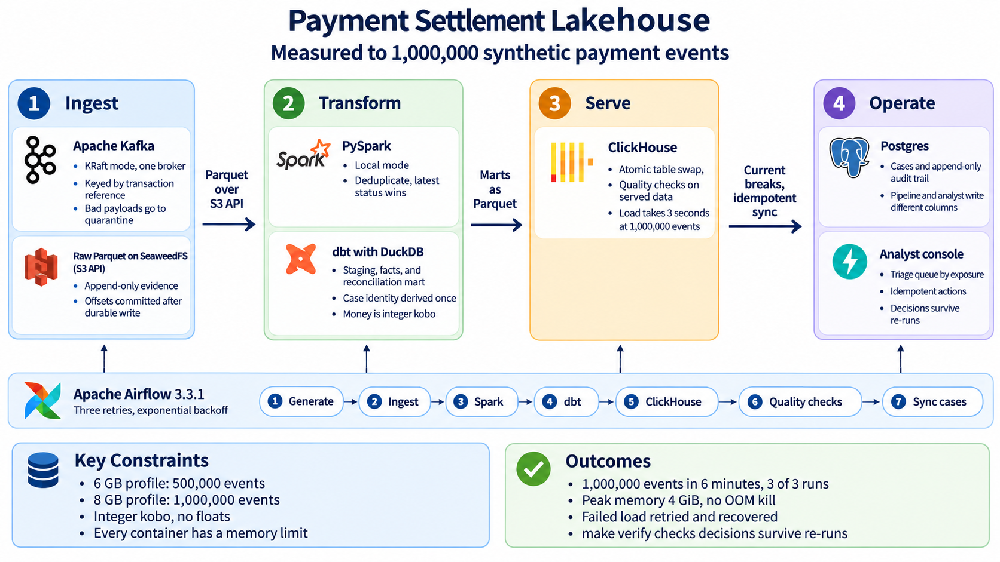
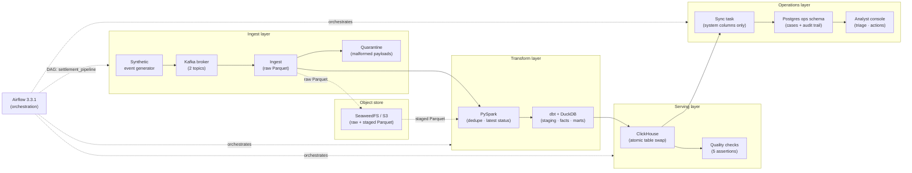

# Payment Settlement Lakehouse

[](https://github.com/laurence702/payment-settlement-lakehouse/actions/workflows/tests.yml)
[](https://github.com/laurence702/payment-settlement-lakehouse/actions/workflows/e2e.yml)
[](https://airflow.apache.org/)
[-231F20?logo=apachekafka&logoColor=white)](https://kafka.apache.org/)
[](https://spark.apache.org/)
[](https://docs.getdbt.com/)
[](https://clickhouse.com/)
[](LICENSE)

Payment Settlement Lakehouse is a local, production-shaped data pipeline for
reconciling **synthetic Paystack/Flutterwave-shaped events**. It models how a
data platform can identify settlement gaps and amount discrepancies while
preserving raw evidence, deterministic transforms, and clear data-quality
states.

It is not a payment processor. It has no official Paystack or Flutterwave
integration, real customer data, banking access, or production deployment. No
real money is moved.

## The question it answers

> For eligible successful synthetic charges, which have no verified settlement
> line, what net amount is expected or outstanding, and is the settlement
> source current enough to make that conclusion?

The result is a synthetic reconciliation signal. It does not prove that money
reached a merchant bank account.

## Architecture





The local stack is Kafka, SeaweedFS-compatible object storage (S3-API), PySpark,
dbt with DuckDB, ClickHouse, and Airflow. It is designed for a 6 GB Docker VM
(e.g., Docker Desktop or Colima); see [ADR 0003](docs/adr/0003-profiles-and-the-6gb-budget.md).

## Benchmarks

Scale, measured with `make benchmark` / `--attach` (full tables, memory peaks and
caveats in [docs/benchmarks.md](docs/benchmarks.md)):

| Events | Profile | Outcome | Airflow run time |
|---|---|---|---|
| 20,000 to 500,000 | 6 GB (default), 5 or more runs per size | all succeeded (author-reported, runs before a machine reformat were not recorded) | n/a |
| 500,000 | 6 GB (default), recorded run | succeeded, scheduler container (hosts the Spark driver) at 1,790 of 1,800 MiB | 293 s |
| 1,000,000 | 6 GB (default) | failed in `spark_raw_to_staged`, scheduler container at its ceiling (1,798 of 1,800 MiB) | n/a |
| 1,000,000 | 8 GB (`medium`), 5 runs | 5 of 5 succeeded, no OOM or restart, all containers peaked at 3,910 to 4,448 MiB (4.34 GiB max) | 345 to 357 s (median 349 s) |
| 1,000,000 | `lean` (ceilings sum to 6.7 GiB, 7.8 GiB VM), 3 runs | 3 of 3 succeeded, Kafka at 97% of its ceiling | 352 to 361 s (median 360 s) |

The recorded 6 GB rows ran on 2 CPUs; the 8 GB rows ran on 8 CPUs. They are
not a scaling curve.

The 100,000-event run below is the original reference run.

Numbers from the last successful end-to-end run inside a 6 GB
Docker VM (`manual__2026-09-28T07:18:08` · 100,000 synthetic events):

| Metric | Value |
|---|---|
| End-to-end DAG runtime | **75 seconds** |
| Total transaction value | **₦1.6 billion** |
| Outstanding synthetic exposure | **₦51.3 million** |
| `fct_transactions` | 100,000 rows · 7.84 MiB |
| `fct_settlements` | 85,180 rows · 5.38 MiB |
| `mart_settlement_reconciliation` | 87,910 rows · 6.27 MiB |
| Match rate | 93.4% `matched` |
| Missing settlement | 2,731 transactions |
| Amount-mismatched rows | 3,054 rows |
| Merchants / Customers / Days | 40 / 95,085 / 14 |
| Automated tests (current suite) | **182** (unit, Spark, dbt, ops store, console) |

## Data and reconciliation flow

The seeded generator emits duplicates, out-of-order status events, missing
settlements, reversals, amount discrepancies, merchant T+1/T+2 rules, and
shared payout batches. Money remains integer kobo end to end.

1. Kafka carries transaction and settlement events keyed by `transaction_ref`.
2. Ingest writes append-only raw Parquet and commits Kafka offsets only after
   durable writes. Malformed payloads are retained separately with bounded raw
   payload, source topic, time, and safe error metadata.
3. Spark removes duplicate event IDs and selects the latest transaction status
   with a deterministic status-rank tie-break.
4. dbt derives transaction facts, settlement-line facts, expected settlement
   dates, and the reconciliation mart.
5. ClickHouse serves the parquet marts after an atomic table swap.

`mart_settlement_reconciliation` retains v0.1-compatible `is_settled` and
`reconciliation_bucket` fields. New consumers should use these fields:

| Field | Meaning |
|---|---|
| `expected_net_kobo` | Charge net expected in NGN kobo. |
| `settled_net_kobo` | Settlement-line net amount, if present. |
| `settlement_variance_kobo` | Settled minus expected net amount. |
| `outstanding_net_kobo` | Expected amount still unpaid; zero for matched, overpaid, and reversal-after-settlement cases. |
| `expected_settlement_date` | Success date plus the merchant's synthetic T+1 or T+2 rule. |
| `source_freshness_status` | `fresh` or `stale_or_incomplete`, based on synthetic settlement-report watermark coverage. |

`reconciliation_status` is one of `matched`, `missing_settlement`,
`partial_settlement`, `short_paid`, `overpaid`, `reversed_after_settlement`, or
`unverified_source`. `unverified_source` prevents a stale or incomplete
synthetic settlement feed from being represented as a missing-settlement
breach. A `payout_id` connects multiple settlement lines to a synthetic payout
batch while preserving `transaction_ref` compatibility.

## What happens to a break

A reconciliation mart that stops at a table leaves the real question open: who
owns the rows that need a human, and what stops the next pipeline run from
undoing their work? The operations layer answers both. See
[ADR 0007](docs/adr/0007-ops-case-management.md) for the decisions.

- **A break is defined, not implied.** `short_paid`, `partial_settlement`,
  `overpaid`, `reversed_after_settlement`, and `missing_settlement` past its SLA
  are breaks. `matched`, `unverified_source`, and anything still within its SLA
  are not, so a stale source never opens a case.
- **Identity is deterministic and produced once.** dbt computes `case_id` as the
  SHA-256 of the transaction reference, so a re-run yields the same id. Python
  never recomputes it.
- **Two writers, two sets of columns.** The pipeline sync writes only what the
  pipeline knows (is it still a break, how much is at risk). Analyst actions
  write only the decision. The status an analyst sees is derived from both, so
  no pipeline run can overwrite a decision.
- **The audit trail is append-only and idempotent.** Every action carries an
  idempotency key; a retry replays instead of recording twice. A database
  trigger, not application code, rejects edits and deletes to the trail.
- **A decision on moved facts is flagged, not trusted.** If a closed case's break
  type or exposure changes in a later run, the console marks it for review.
- **`make verify` proves the guarantee.** It closes a break through the console,
  runs the whole pipeline again from the same events, and fails unless the case
  is still closed with exactly one audit row.

The console is a small FastAPI app on its own slim image, in the optional `ops`
compose profile, on `127.0.0.1` only. Case state lives in the stack's existing
Postgres server in its own database; ClickHouse and DuckDB are not used for
single-row mutable state. The 128 MB it needs is funded from the existing
budget, not added to it (ADR 0003).

## Run locally

Use Docker Desktop or Colima configured with 6 GB RAM and Docker Compose v2.

```bash
git clone https://github.com/laurence702/payment-settlement-lakehouse
cd payment-settlement-lakehouse

make bootstrap
make preflight
make build
make demo
```

`make bootstrap` creates the local `.env` and generated development secrets.
`make preflight` verifies Docker, memory, disk, ports, pins, and environment
configuration. `make demo` starts the required services, triggers the Airflow
DAG, and prints the reconciled ClickHouse tables in your terminal. When the run
finishes, the analyst console is at `http://127.0.0.1:8090` (the port is
`PORT_OPS` in `.env`).

### Custom scale via terminal (e.g. 200k transactions)

To run a custom transaction volume from the terminal without using the Airflow
UI, pass `GEN_EVENT_COUNT`:

```bash
# End-to-end start to ClickHouse summary for 200,000 transactions:
GEN_EVENT_COUNT=200000 make demo
```

If the stack is already running, trigger a 200k run directly via the Airflow CLI
with a fresh consumer group:

```bash
make dag-trigger ARGS='--conf "{\"event_count\": 200000, \"consumer_group_suffix\": \"run200k\"}"'
```

## Test commands

```bash
make venv
make lint
make test-fast
make test-spark
make test-dbt
make test-ops
make test
make verify
make e2e
```

`make test-ops` starts a throwaway Postgres container and runs the ops store
and console tests against it. The same contract tests run against an in-memory
store, which is what keeps the fast suite honest.
`make test` runs unit, Spark, and dbt tests without the Docker stack.
`make verify` is the full Docker end-to-end verification; it requires enough
local Docker capacity and validates the DAG, container health, and non-empty
reconciliation output.
`make e2e` resets the stack, then a Playwright browser logs in to Airflow,
fills the trigger dialog and runs the pipeline from the UI. It asserts that
every task succeeded on its first try and that the analyst console received the
breaks. Install the browser once with `make e2e-setup`. `E2E_EVENTS` sets the
volume (default 5,000); screenshots land in `e2e-report/`.

### Scaling and benchmarks

The 6 GB profile is the default. To measure how far the pipeline goes with more
room, switch profile and let the runner repeat full runs from empty volumes:

```bash
make profile PROFILE=medium         # an 8 GB Docker VM; PROFILE=large is the 10 GB ceiling
make benchmark EVENTS="500000 1000000" RUNS=3 PROFILE=medium
```

Each run records task durations, every container's peak memory, OOM kills,
restarts and the final mart row count. Failed runs are recorded, not retried.
Use `--attach` (`python scripts/benchmark.py --attach`) to measure a run you
start yourself from the Airflow UI. Tasks that are safe to repeat retry three
times with exponential backoff ([ADR 0008](docs/adr/0008-retries-and-backoff.md));
`make chaos-retry` stops ClickHouse mid-run to prove it recovers.
Records and a `summary.md` land in `benchmark-runs/` (gitignored); see
[docs/benchmarks.md](docs/benchmarks.md) for what has been measured so far.

## Data-quality guarantees

- Explicit Arrow schemas are used rather than inferred JSON schemas.
- Raw data is append-only and retains duplicates and out-of-order records.
- Kafka offsets are manually committed only after raw Parquet writes complete.
- Malformed messages are quarantined instead of silently dropped.
- Transaction collapse is deterministic for equal timestamps.
- Monetary values are integer kobo, including expected, settled, variance, and
  outstanding amounts.
- dbt tests enforce key uniqueness, required fields, allowed reconciliation and
  freshness states, and basic source relationships.
- Pytest covers generator pathologies, quarantine records, real Spark staging,
  dbt models built from staged Parquet, the ops store contract and the console
  (171 tests across 10 modules).

## Known limitations

- The source watermark is deterministic synthetic metadata, not a provider
  report API or a completeness guarantee from a real PSP.
- Settlement lines are synthetic charge-to-line mappings. Payout batches are
  represented, but bank credits, payout adjustments, reserves, and fees beyond
  the modeled line are not reconciled.
- Merchant rules are synthetic calendar-day T+1/T+2 rules. Business-day
  calendars, provider cutoffs, holidays, channel-specific rules, and timezone
  policy are future work.
- A matching synthetic settlement line does not prove merchant bank receipt.
- There are no signed webhooks, provider API/report ingestion, schema registry,
  replicas, production monitoring, CDC, or incremental dbt models.
- Kafka uses one broker and replication factor one. Spark runs locally and
  stages object-store inputs through local files to stay within the memory
  envelope.
- The analyst console has no authentication. It binds to loopback and takes an
  analyst name per request, so the audit trail records what a user typed, not a
  verified identity. Real use needs SSO and roles.
- The console, the sync task and the migrations connect to Postgres as the
  stack's single local superuser. A deployed system would use separate
  least-privilege roles for migrations, the sync and the console.
- A case is one row per transaction. A transaction that breaks, is fixed, and
  breaks again shows as one case with its history in the audit trail, not as
  separate cases.
- The queue pages with `LIMIT`/`OFFSET`, which is fine for thousands of breaks
  and would move to keyset pagination before it met millions.

## v0.2 and roadmap

Implemented in v0.2:

- Amount-aware reconciliation with a 7-state `reconciliation_status` and
  integer-kobo variance and outstanding-balance fields.
- Merchant-specific expected settlement dates anchored to the original success
  event, with per-merchant T+1/T+2 SLA classification.
- Synthetic source freshness and completeness signaling: `unverified_source`
  prevents a stale settlement feed from being counted as a breach.
- Payout-batch identifiers on settlement lines, preserving `transaction_ref`
  grain in `fct_settlements`.
- Append-only malformed-message quarantine with bounded raw payload retention.
- Quality-check grain fix: assertion #4 now mirrors the mart grain, including
  `reversed_after_settlement` rows present in `fct_settlements`.

Benchmark (100k events, 6 GB VM):
75-second end-to-end run · ₦1.6B total value · ₦51.3M synthetic outstanding
exposure surfaced · 93.4% match rate. The suite has since grown to 171
automated tests.

Later real-world requirements include signed provider webhooks and report/API
ingestion, trusted completeness contracts and cutoffs, payout adjustments and
bank-credit reconciliation, business calendars and auditable FX, schema
registry and replicas, plus production monitoring and deployment controls.

## Repository layout

```text
dags/                     Airflow orchestration
src/settlement/             generator, schemas, ingest, Spark, serving, checks
src/settlement/ops/         case lifecycle, Postgres store, sync, analyst console
dbt/settlement/             staging models, facts, marts, and data tests
docs/adr/                 architecture decisions
scripts/                  bootstrap, preflight, demo, and verification helpers
```

## Licence

MIT. See [LICENSE](LICENSE).
